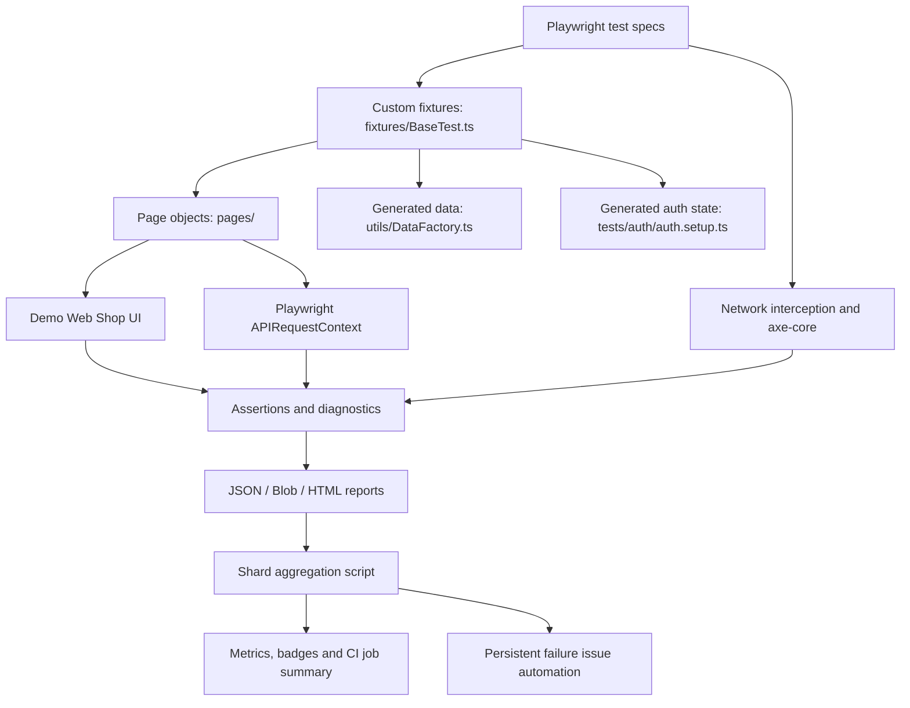
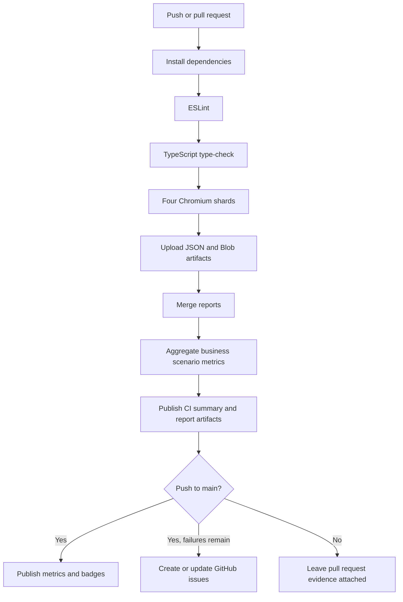

# Framework Architecture

## Test execution path

## CI pipeline

## Responsibilities

| Component | Responsibility |
|---|---|
| `tests/` | Scenario intent and business-level assertions |
| `fixtures/BaseTest.ts` | Constructs page objects for each Playwright test |
| `pages/` | Locators and reusable UI workflows |
| `utils/DataFactory.ts` | UUID-backed disposable test identities and Faker data |
| `utils/auth-user.ts` | Reads the generated setup account without committing credentials |
| `playwright.config.ts` | Browser project, setup dependency, retries and reporters |
| `scripts/summarize-playwright-results.mjs` | Aggregates unique business tests across sharded JSON reports |
| `scripts/create-playwright-issues.mjs` | Creates or updates GitHub issues for persistent test failures |

## Isolation model

Playwright creates a new browser context for each test. Guest tests override the default storage state with an empty context. Authenticated tests use the storage state created by the setup project. The setup account and storage-state files live under `playwright/.auth/`, which is ignored by Git.

## Metric model

The headline dashboard counts unique business test scenarios by spec identity. The `setup` project is excluded from pass-rate denominators and shown separately. A scenario is classified as passed, failed, flaky or skipped. Retries do not convert a final failure into a pass.

See [KNOWN-ISSUES.md](KNOWN-ISSUES.md) for currently observed behaviour that still fails validation.
