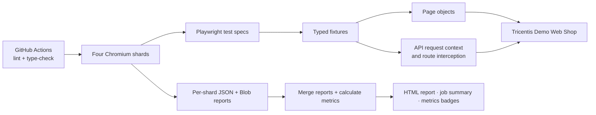

# E-commerce End-to-End Automation Framework

[](https://github.com/vilayatalimirza/ecommerce-playwright-framework/actions/workflows/playwright.yml)
[](https://github.com/vilayatalimirza/ecommerce-playwright-framework/actions/workflows/playwright.yml)
[](https://github.com/vilayatalimirza/ecommerce-playwright-framework/actions/workflows/playwright.yml)
[](https://github.com/vilayatalimirza/ecommerce-playwright-framework/actions/workflows/playwright.yml)
[](https://github.com/vilayatalimirza/ecommerce-playwright-framework/actions/workflows/playwright.yml)
[](https://github.com/vilayatalimirza/ecommerce-playwright-framework/actions/workflows/playwright.yml)

A Playwright + TypeScript end-to-end test automation project for the public [Tricentis Demo Web Shop](https://demowebshop.tricentis.com/). The suite exercises customer journeys across authentication, catalogue, product details, cart, checkout, account management and order history. It also includes API-assisted setup, network mocking, accessibility checks, visual snapshots and CI diagnostics.

> **Test results are published, not polished.** Failed, flaky and skipped tests are reported separately. A failing CI run remains failing; retries do not silently convert it into a clean pass.

## CI evidence

The badges read machine-readable metrics generated by the latest **main-branch** workflow. Open the [workflow history](https://github.com/vilayatalimirza/ecommerce-playwright-framework/actions/workflows/playwright.yml) for shard logs and retained report artifacts.

### Latest main-branch run

The latest completed main-branch workflow is [run #63, completed on 18 November 2026](https://github.com/vilayatalimirza/ecommerce-playwright-framework/actions/runs/44395124618), on commit `3300a52`. The workflow completed successfully and is labelled **PASSED WITH FLAKINESS**.

| Functional outcome | Count |
|---|---:|
| Passed on first attempt | 89 |
| Flaky (passed on retry) | 1 |
| Failed after retries | 0 |
| Skipped | 1 |
| **Total functional outcomes** | **91** |

Four authentication setup executions also passed. They are reported separately and excluded from functional test rates.

| Functional rate | Value |
|---|---:|
| **Eventual functional success rate** | **100% (90/90 eligible tests)** |
| First-attempt pass rate | 98.9% |
| Flaky rate | 1.1% |
| Final failure rate | 0% |

The one flaky test is the address-deletion scenario: it failed on its first attempt and passed on retry. The one skipped test checks volume-tier pricing, which is not configured for the selected public demo product. The skipped test and authentication setup executions are excluded from the functional-rate denominator.

All four Chromium shards, code-quality/type-check, report aggregation, and metrics publishing completed successfully. The run had no final functional failures, but the retry-passed test remains visible as flaky.

### Recent run history

| Run | Context | Passed first try | Flaky | Failed after retries | Skipped | Setup passed | First-attempt rate | Eventual success | Result |
|---|---|---:|---:|---:|---:|---:|---:|---:|---|
| [#63](https://github.com/vilayatalimirza/ecommerce-playwright-framework/actions/runs/44395124618) | main | 89 | 1 | 0 | 1 | 4 | 98.9% | **100%** | Passed with flakiness |
| [#61](https://github.com/vilayatalimirza/ecommerce-playwright-framework/actions/runs/43768877899) | main | 89 | 0 | 1 | 1 | 4 | 98.9% | 98.9% | Failed |
| [#58](https://github.com/vilayatalimirza/ecommerce-playwright-framework/actions/runs/43767353876) | draft PR | 89 | 1 | 0 | 1 | 4 | 98.9% | **100%** | Passed with flakiness |

The address-deletion scenario remains the recurring area to watch. It was a final failure in run #61 and passed only after retry in run #63. The skipped volume-tier pricing scenario is a limitation of the selected public demo product, not a test failure. Current reproduction notes are recorded in [KNOWN-ISSUES.md](KNOWN-ISSUES.md).

## Coverage

The [test suite map](tests/README.md) groups the specs by business capability. The current suite includes scenarios for:

- Registration, login and invalid authentication.
- Product catalogue, product details, search and sorting.
- Shopping cart, quantity updates, discount and gift-card validation.
- Guest and authenticated checkout paths.
- Customer addresses, account management, order history and order details.
- API-assisted cart setup and network-failure simulation.
- Accessibility scans with axe-core and visual snapshot assertions.

The configured CI browser project is **Chromium**. Other browser engines are not claimed as covered by the current pipeline.

## Framework design

See the [architecture guide](ARCHITECTURE.md) for the test execution and CI flow diagrams.

- **Page Object Model:** page classes keep selectors and user interactions out of test specifications.
- **Custom fixtures:** `fixtures/BaseTest.ts` constructs page objects on demand through Playwright's fixture system.
- **Generated test data:** Faker supplies test data; UUID-based email addresses reduce collisions between parallel tests.
- **Session setup:** a Playwright setup project creates authenticated browser state for tests that need it. Guest tests explicitly use an empty storage state.
- **API and network testing:** selected flows use Playwright's API request context and route interception alongside browser testing.
- **CI distribution:** GitHub Actions runs four Chromium shards, merges Blob reports and produces an aggregated status summary.

## Architecture at a glance



## Project structure

```text
.
├── .github/workflows/       # quality checks, sharded CI and snapshot workflow
├── fixtures/                # typed Playwright page-object fixtures
├── pages/                   # page objects for application areas
├── scripts/                 # CI issue creation and result aggregation
├── tests/                   # specs organised by business domain
│   ├── auth/
│   ├── catalog/
│   ├── cart/
│   ├── checkout/
│   ├── account/
│   ├── quality/
│   └── README.md
├── utils/                   # generated test data helpers
├── metrics/                 # CI metrics history and Shields badge endpoints
├── package.json
├── playwright.config.ts
├── tsconfig.json
└── README.md
```

## Run locally

### Requirements

- Node.js LTS
- npm

### Install

```bash
git clone https://github.com/vilayatalimirza/ecommerce-playwright-framework.git
cd ecommerce-playwright-framework
npm ci
npx playwright install chromium
```

### Execute

```bash
# Static checks
npm run lint
npm run typecheck

# Full configured Chromium suite
npm test

# Tagged subsets
npm run test:smoke
npm run test:sanity

# Focused suites by business domain
npm run test:auth
npm run test:catalog
npm run test:cart
npm run test:checkout
npm run test:account
npm run test:quality

# Interactive Playwright UI
npx playwright test --ui

# Open the local HTML report after a run
npx playwright show-report
```

Set `BASE_URL` to target another compatible environment. Set `FAKER_SEED` when you need repeatable Faker-generated values during local debugging. Do not use real personal credentials or production customer data in this demo project.

## CI reporting and artifacts

The workflow:

1. Runs ESLint and the TypeScript compiler.
2. Executes the Chromium suite across four shards.
3. Uploads each shard's Blob and JSON results even when tests fail.
4. Merges Blob reports into one HTML report.
5. Aggregates passed, failed, flaky and skipped counts into the GitHub Actions job summary.
6. Publishes machine-readable metrics for badges on main-branch runs.
7. Runs optional persistent-failure issue automation on pushes to `main`.

The test job remains red when a shard has a final failure. The reporting job still runs after test failures so evidence remains available.

## Known limitations

- The target is a shared public demo application, not an isolated test environment. Availability, seeded catalogue data and server-side state can affect results.
- The CI workflow currently executes Chromium only.
- A single run is a snapshot, not a statistically meaningful reliability trend. Use multiple runs before drawing conclusions about stability.
- Metrics count test outcomes across shards. The authentication setup project may execute once per shard, so totals are not unique test-case counts.

## License

No license has been declared. Add one only after deciding how you want others to reuse this project.
